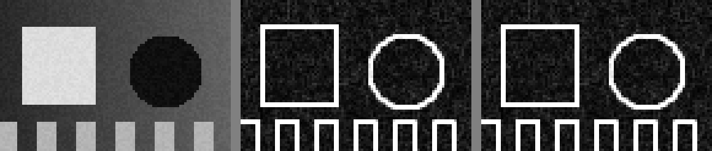
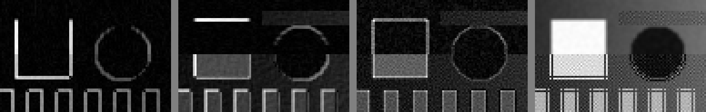

# FPGA Accelerator, Stage 3: systolic convolution engines

Stage 3 of a small image-processing accelerator in Verilog on a Xilinx Virtex-6 (ML605 board,
XC6VLX240T). It turns the programmable 3x3 convolution engine from Stage 2 into a **systolic
array**, the structure used by TPU-style neural-network accelerators (3a), and then into a small
**convolution layer** with 4 filters and weights loaded at runtime (3b).

| | 3a: systolic Sobel | 3b: 4-filter conv layer |
|---|---|---|
| Filters / weights | 2, fixed | 4, runtime, two banks |
| DSP48E1s | 18 | 36 |
| Est. clock | 328 MHz | 365 MHz |
| Simulation | PASS | PASS |

Stages 1–2 (the MAC unit and the five Sobel edge-detector versions this work starts from) are in
[fpga-accelerator-stage2](https://github.com/solistolen/fpga-accelerator-stage2).



*Left: 96x64 test image. Middle: edges from the Python golden model. Right: edges produced by the
Stage 3a Verilog in simulation. All 5,828 output pixels match.*

## Stage 3a: systolic 3x3 engine

In Stage 2d the slowest path was one hop between two DSP48E1s: one DSP added its product to the
partial sum and passed the result on **unregistered**, so the next DSP did a second add in the same
clock (3.70 ns). `conv3x3_sys` is a systolic chain: every tap stores its partial sum in its DSP's
P register, and the next tap adds to it on the next clock.

```
tap 0:  P0 <= x0*w0
tap 1:  P1 <= P0 + x1*w1        (P0 from the previous clock)
...
tap 8:  P8 <= P7 + x8*w8        = finished sum
```

The partial sum reaches tap *i* exactly *i* clocks after tap 0, so pixel *i* is delayed by *i*
clocks too (the "skew" delay line in each tap). Latency is 11 clocks; throughput is still one
3x3 window per clock, and the engine is still **programmable** (coefficients on a port).

### Results

XST synthesis estimates (ISE 14.7, xc6vlx240t-1-ff1156, `IMG_W = 640`), before place-and-route,
compared with the Stage 2 designs it replaces:

| | 2d (programmable) | 2e (fixed Sobel) | **3a (programmable, systolic)** |
|---|---|---|---|
| DSP48E1s | 18 | 0 | 18 |
| Block RAM (RAMB18) | 1 | 1 | 1 |
| Slice LUTs (incl. SRLs) | 255 | 227 | 239 (86 SRLs) |
| Slice registers | 206 | 248 | 278 |
| Slowest path | DSP→DSP hop (two adds) | BRAM read → write | magnitude add/clamp (fabric) |
| Period | 3.70 ns | 2.74 ns | 3.05 ns |
| **Est. clock** | **270 MHz** | **365 MHz** | **328 MHz** |
| Latency (clocks) | 7 | 6 | 15 |

- Every DSP runs with its multiplier and output registers on (XST: "registers also absorbed by the
  MAC: `m_r`, `pout`"), and the slowest path is no longer anywhere in the DSP chain. The
  programmable engine is within ~10% of the fixed Sobel's clock.
- Gx and Gy delay the same pixels, so XST merged their skew delay lines: the whole skew costs
  48 SRLs.
- Coefficients must only change while the engine is idle (each tap samples its coefficient at a
  different time). Stage 3b loads weights properly.

Report excerpt with the critical path: [`results/synthesis/3a_systolic_xst.txt`](results/synthesis/3a_systolic_xst.txt).

### Verification

Both testbenches pass in ISim 14.7 and Icarus Verilog 12:

- `tb_conv_sys` (unit test, no data files): `PASS: 7500 windows matched the reference (latency 11)`.
  25 coefficient sets (both Sobel kernels, all −128, all +127, a different value in every tap,
  and 20 random sets) × 300 random windows, with ~25% idle clocks.
- `tb_sobel` (full streaming Sobel against the Python golden model):
  `PASS: 5828 edge pixels matched the golden model`.

Planted bugs, to check the testbenches catch real mistakes:

| Bug | tb_conv_sys | tb_sobel |
|---|---|---|
| No skew (all delays 0) | FAIL | FAIL |
| Tap 4's delay off by one | FAIL | *passes*: tap 4 is the centre pixel, coefficient 0 in both Sobel kernels |
| Pixel sign-extended instead of zero-extended | FAIL | FAIL |
| Coefficient register unsigned | FAIL | FAIL |
| Valid-flag latency 10 instead of 11 | | FAIL |
| 10-clock drain at the end of tb_sobel | | FAIL (outputs missing) |

The tap-4 row is why the unit test uses a different coefficient in every tap.

## Stage 3b: a convolution layer with runtime weights

`conv_layer` runs **4 filters** (output channels) on the same 3x3 window in parallel, one window
per clock, with weights **loaded at runtime** through a write port. `feature_stream` puts it behind
the same line buffer and window as before, so a pixel stream goes in and 4 feature maps come out.

- **Shared skew.** Each tap's pixel delay is built once and fanned out to all 4 filters.
- **Two weight banks (ping-pong buffering).** Every window carries a bank bit through the same skew
  as its pixels, so tap *i* reads the bank exactly when it processes that window's pixel *i*. Banks
  switch between **any two windows with no idle clocks**, windows already in the pipeline finish
  with their own weights, and the idle bank can be rewritten while the other is running, the way
  accelerators load the next layer's weights during the current one.



*Hardware output of the 4 filters (one panel each), from the Stage 3b simulation. Bank A (top, and
the left part of rows 8–15): Sobel Gx, Sobel Gy, Laplacian, Gaussian blur. Bank B (bottom, and the
box at the top right): diagonal edges, emboss, sharpen, and a ±127/−128 "extremes" kernel. The box
switches weights in the middle of each row and back at the row end.*

### Weight port rules

- Write only the bank that the incoming windows are **not** using.
- A bank may be overwritten starting **8 clock edges after the last window that used it** entered
  `conv_layer` (tap 8 reads its weight 8 clocks after its window arrives). Measured with the unit
  test: one clock earlier fails.
- Don't switch to a bank while it is being rewritten.
- Address = filter × 9 + tap (tap 0 = top-left … tap 8 = bottom-right); weights are signed int8.

### Results: how storage is written decides the hardware

The first version stored each weight bank as an array, `reg [7:0] wA [0:35]`. Each of the 36 taps
reads its own weight every clock, so the array needs 36 read ports. XST made it a small LUT RAM and,
because one RAM has only one or two read ports, **built a separate copy for every tap**. The fix
stores the weights as plain registers packed into a vector (`wA[8*a +: 8]`): same behaviour, same
tests.

| | 3b, weights as arrays | **3b, weights as registers (current)** |
|---|---|---|
| DSP48E1s | 36 | 36 |
| Block RAM | 1 | 1 |
| Slice LUTs | 1,238 (**864 as LUT RAM**) | **453** (no LUT RAM) |
| Slice registers | 198 | 774 (+576 weight bits) |
| Bonded IOBs | 109 | 109 |
| Slowest path | weight LUT-RAM read → bank mux → DSP | line-buffer BRAM read → write |
| Period | 2.94 ns | 2.74 ns |
| **Est. clock** | **340 MHz** | **365 MHz** |
| Latency (clocks) | 13 | 13 |

- Doubling the filters from 3a doubled the DSPs (18 → 36) without lowering the clock: each filter
  is its own systolic chain running in parallel. 365 MHz equals the fixed-coefficient Sobel from
  Stage 2e: the arithmetic is no longer the limit, the line-buffer block RAM is.
- XST merged each tap's pixel register across the 4 filters, so the 4 DSPs of a tap share one copy.

Report excerpts for both versions: [`results/synthesis/3b_conv_layer_xst.txt`](results/synthesis/3b_conv_layer_xst.txt).

### Verification

- `tb_conv_layer` (unit test, no data files): `PASS: 7523 windows x 4 filters matched the reference
  (159 bank switches, 158 live bank rewrites)`. Banks switch with no idle clocks, and the idle bank
  is rewritten (tap 8 first, the worst case) while the stream keeps running.
- `tb_feature_stream`: `PASS: 5828 pixels x 4 filters matched the golden model (with mid-frame and
  mid-row bank switches)`, against `gen_features.py` with 8 real kernels.
- Both pass in ISim 14.7 too (counts differ slightly because each simulator's `$random` differs).

Planted bugs:

| Bug | tb_conv_layer | tb_feature_stream |
|---|---|---|
| Bank bit not skewed (all taps use the incoming bank) | FAIL | FAIL |
| Every filter reads filter 0's weights | FAIL | FAIL |
| Tap 4's pixel delay off by one | FAIL | FAIL |
| Weight register unsigned | FAIL | FAIL |
| Weight write ignores the bank (writes both) | FAIL | FAIL |
| Window takes the bank of the next pixel | | FAIL |
| Bank rewritten too early (GUARD 3–5) | FAIL | |
| GUARD 6 (the exact minimum) and up | PASS | |

Two test weaknesses found and fixed along the way: with a single bank switch, the "next pixel's
bank" bug only showed up if no idle clock fell at the switch, so the stream test now switches
mid-row 16 times; and rewriting weights in ascending address order can never break the timing
rule, so the unit test writes tap 8 first.

## Repository layout

```
rtl/
  3a_systolic/      conv3x3_sys.v   systolic engine: conv3x3_sys (9 taps) + sys_tap
                    sobel.v         streaming Sobel: line buffer, 3x3 window, 2 x conv3x3_sys, magnitude
  3b_conv_layer/    conv_layer.v    4 filters x 9 taps, two weight banks, shared skew; sys_mac (one DSP tap)
                    feature_stream.v  streaming top: line buffer, 3x3 window, conv_layer, per-pixel bank bit
sim/
  image.hex                         96x64 test image (all testbenches)
  tb_conv_sys.v                     3a unit testbench (no data files)
  tb_sobel.v, expected.txt          3a Sobel testbench + golden results
  tb_conv_layer.v                   3b unit testbench: live bank switches and rewrites (no data files)
  tb_feature_stream.v, weights.hex, features_expected.txt   3b stream testbench + weights + golden results
scripts/
  gen_sobel.py      test image + golden Sobel model, writes image.hex / expected.txt
  gen_features.py   golden model for 3b (8 kernels, 2 banks), writes weights.hex / features_expected.txt
  show_result.py    sim_out.hex -> hardware.png (3a)
  show_features.py  sim_features.hex -> features.png (3b)
  png_util.py       tiny PNG writer (no dependencies)
results/
  synthesis/        XST report excerpts (3a; 3b both versions)
  images/           input, expected, 3a edge images, 3b feature maps
  sim_out_3a.hex, sim_features_3b.hex   raw simulation outputs
```

## Running it

### Xilinx ISE 14.7 / ISim

Use one project per stage (the top modules differ).

1. New project: Virtex-6, xc6vlx240t, ff1156, speed -1, XST, ISim, Verilog.
2. Add the stage's `rtl/` files (association **All**) and its testbenches from `sim/` (association
   **Simulation**). Copy the data files into the project folder (no need to add them):
   - 3a: `tb_conv_sys.v`, `tb_sobel.v`; data `image.hex`, `expected.txt`
   - 3b: `tb_conv_layer.v`, `tb_feature_stream.v`; data `image.hex`, `weights.hex`, `features_expected.txt`
3. Simulation view → select a testbench → Simulate Behavioral Model → `run all`.
4. Implementation view → top = `sobel` (3a) or `feature_stream` (3b) → Synthesize - XST.

### Icarus Verilog (no Xilinx tools needed)

From the `sim/` folder:

```
iverilog -o conv_sim tb_conv_sys.v ../rtl/3a_systolic/conv3x3_sys.v
vvp conv_sim
iverilog -o sobel_sim tb_sobel.v ../rtl/3a_systolic/sobel.v ../rtl/3a_systolic/conv3x3_sys.v
vvp sobel_sim
python ../scripts/show_result.py      # sim_out.hex -> hardware.png

iverilog -o layer_sim tb_conv_layer.v ../rtl/3b_conv_layer/conv_layer.v
vvp layer_sim
iverilog -o feat_sim tb_feature_stream.v ../rtl/3b_conv_layer/feature_stream.v ../rtl/3b_conv_layer/conv_layer.v
vvp feat_sim
python ../scripts/show_features.py    # sim_features.hex -> features.png
```

## Next

- **3c**: CNN-style output stage: bias, ReLU and requantization back to 8 bits.
